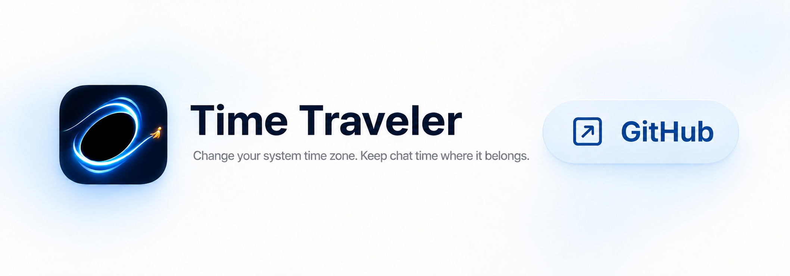
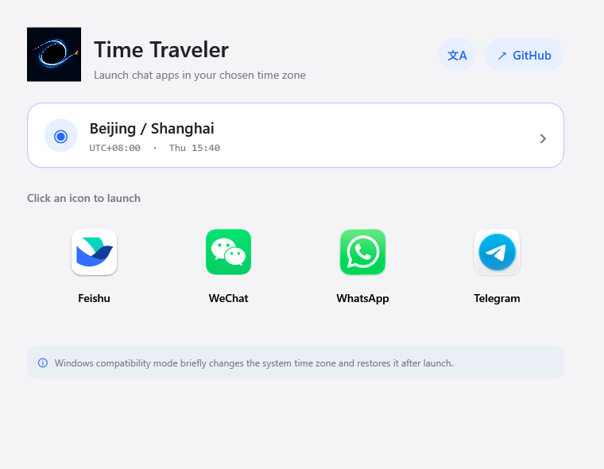
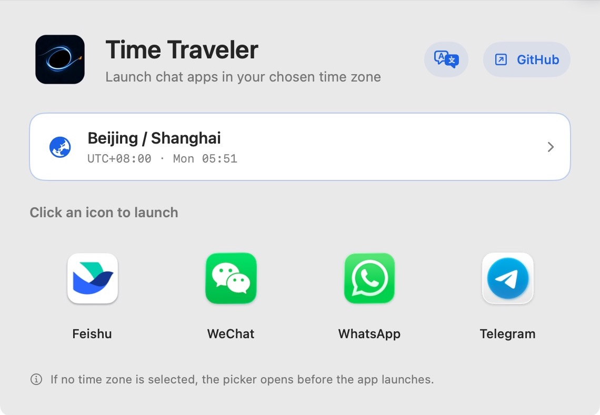

[中文](README.md) · **English**



# Time Traveler

**Your system time zone belongs to your Mac. Your chat time is yours to choose.**

Time Traveler is an open-source time-zone launcher for macOS. Even when your system is set to another country or region's time zone, it lets your chat apps launch in the time zone you choose—keeping message timestamps, calendars, and work schedules consistent.

[Download the latest release](https://github.com/jockerxb/Time-Traveler/releases/latest) · [View source](https://github.com/jockerxb/Time-Traveler)

**Windows preview:** [Download for x64 / ARM64](https://github.com/jockerxb/Time-Traveler/releases/tag/v1.4.0-preview.1) · [User guide](Windows/README_EN.md). Choose a time zone and click an app icon. Windows briefly switches its system time zone during launch, then restores it automatically. Display compatibility with the real IM clients is still being validated.

<details>
<summary>View the Windows interface in English</summary>



</details>

## Use Case

When you change your Mac's system time zone but still want Feishu, WeChat, and other IM apps to use their usual local time zone, Time Traveler keeps message and calendar times from shifting with the system.

## Core Features



- Choose a separate launch time zone for **Feishu, WeChat, WhatsApp, and Telegram**. Your system time zone stays unchanged or is restored automatically after launch.
- Runs locally and is fully open source. It never uploads chat content or personal data.
- Does not inject into or modify app processes, and does not simulate account activity. It is not a cheat or plug-in and does not create the kind of behavior associated with such tools. Account safety still depends on each app's latest policies.

## System Requirements

| Item | Supported |
| --- | --- |
| macOS | macOS 13 Ventura or later |
| Mac chips | Apple Silicon and Intel |
| Chat apps | Feishu, WeChat, WhatsApp, Telegram |
| Interface languages | Chinese and English |

### Build from Source

Install Xcode Command Line Tools, then run:

```sh
./test.sh
./build.sh universal
```

The built app will be available at `dist/Time Traveler.app`.

> [!IMPORTANT]
> ### macOS says it cannot verify the developer on first launch
>
> The current public release has not been notarized by Apple. On first launch, locate **Time Traveler.app** in Finder, right-click it, choose **Open**, and confirm **Open** again.
>
> If macOS still blocks the app, go to **System Settings → Privacy & Security** and click **Open Anyway** in the Security section. You do not need to disable Gatekeeper or reduce your Mac's overall security settings.

## Support Time Traveler

If Time Traveler solves your time-zone problem, please click **⭐ Star** in the upper-right corner of the GitHub page so more people with the same need can find it.

[⭐ Star Time Traveler on GitHub](https://github.com/jockerxb/Time-Traveler)
